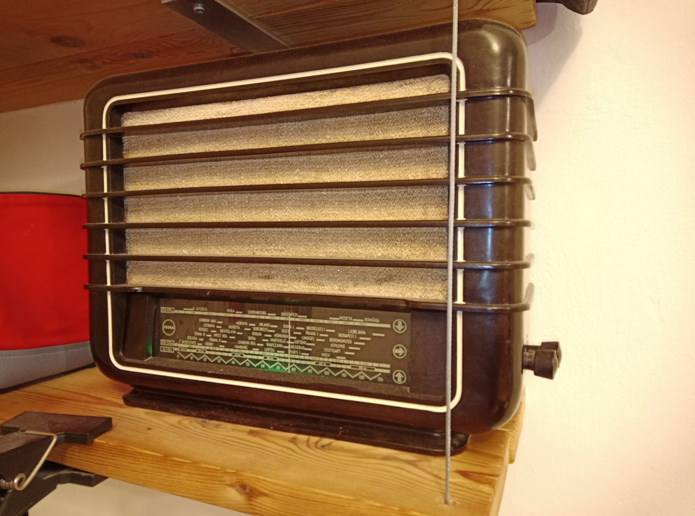
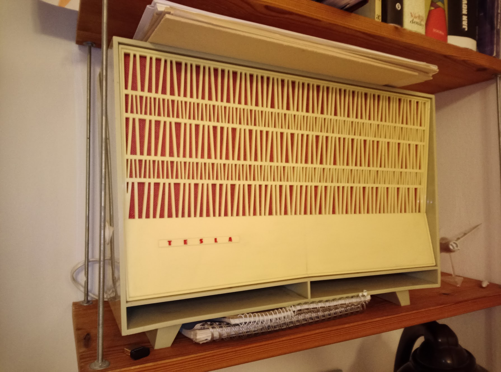

# rpi-radio
A few scripts I use to play on-line radios and stream from other devices using a rpi. Built around 2013, still going strong, though many things may be fine-tuned or completely rewritten...

* The SD card has to be set to RO mode so it can last almost forever ("ro" cmdline.txt)
* Startup set in .bashrc (loads after autologin), must add netctl profile there for the device to connect after the boot
* For streaming from other pcs (expect approx 400ms ms delay) set the IP adress of the rpi in stream.sdp
* radio.py just checking button press on an rpi pin - set the pin there to switch the stations
* set the stations URLs in rozhlas.sh.

  That's all... on streaming machine, set audio output to loopback and run something like:
  ffmpeg -f alsa -ac 2 -i hw:Loopback,1,0 -acodec libmp3lame -b:a 64k -f rtp  rtp://W.X.Y.Z:6000

  where W.X.Y.Z is the IP of the rpi

  Looks and works great in old radio cases. 

  
  
